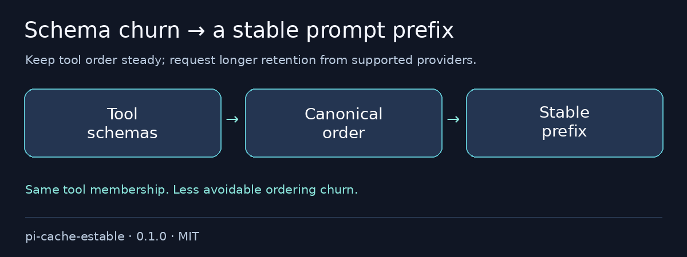

# @otixe/pi-cache-estable

Your tools are the same, but their schemas keep moving around and breaking the prompt prefix. Keep tool order steady and request longer cache retention from supported providers, without changing which tools the agent can use.

[Español](README.es.md) · MIT

## Problems it removes

- Reordered schemas breaking a stable prefix → checked canonical tool ordering.
- Short default retention → opt-in long-retention preference.
- Configuration/runtime tool drift → best-effort coherence diagnostics.



## Install in one command

From a reviewed local checkout:

```sh
pi install ./packages/pi-cache-estable
```

### Configuration

Installing sets `PI_CACHE_RETENTION=long` only if it is unset. Preserve/set `PI_CACHE_RETENTION=short` to choose short retention, or `PI_CACHE_ESTABLE_RETENTION` for the package default.

Optional `.pi/tools-order.json`:

```json
{"version":1,"priority":["read","bash","edit","write","plan_*"],"unlisted":"alphabetical"}
```

The checked `AgentSession` adapter targets Pi 1.4.0; unsupported hosts fail with `TOOLS_ORDER_UNSUPPORTED_HOST`. Missing/invalid order configuration is transparent. Avoid unnecessary membership changes even when ordering is stable.

## Validation and rollback

To remove, `pi remove SOURCE`, then reload/restart your test session; preserve logs, snapshots and sessions.

Full monorepo configuration and reproducible validation: [README](https://github.com/otixe/pi-oficinas/blob/main/README.md), [VALIDATION](https://github.com/otixe/pi-oficinas/blob/main/VALIDATION.md).

## Security & limits

Provider support, pricing and cache hits vary; **no fixed TTL, savings or hit rate are guaranteed**. The adapter preserves membership and cannot grant permissions. Diagnostics never authenticate declared agent names. Stable ordering is not a security sandbox or proof of a cache hit.

Validated on Pi 1.4.0; the five host packages are peerDependencies `"*"`, never bundled copies. Wildcard peers do not promise every host version. Review source/trust before installation: extensions run with process permissions. Tests use model/backend doubles and do not certify production authentication.

For local archives, extract the tarball and install its `package` directory: Pi 1.4.0 does not load `.tgz` extension sources even when `pi install` succeeds. The literal install exits 0; print/load exits 1. The monorepo README shows the supported extraction command.

Registry installation uses `pi install npm:@otixe/pi-cache-estable@0.1.0` once the publisher releases that version. npm sources and repository/gallery URLs require separately authorized publication; a local checkout does not make them available.
