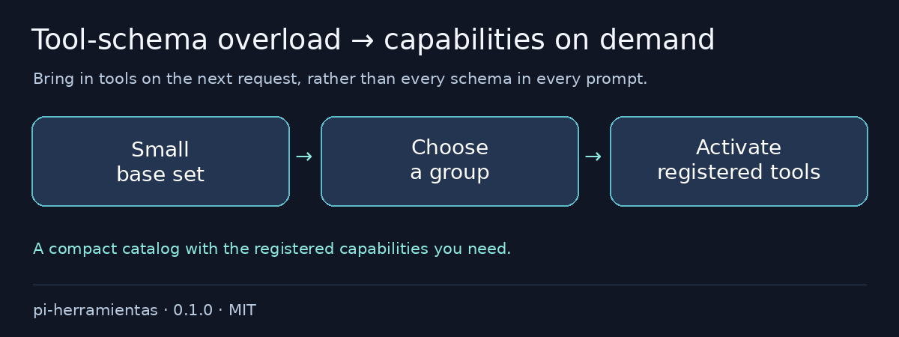

# @otixe/pi-herramientas

Every tool schema rides along even when the task needs only two. Start with a compact catalog, then activate registered tools as the work calls for them: a leaner initial prompt without throwing capabilities away.

[Español](README.es.md) · MIT

## Problems it removes

- All tool schemas in every request → compact group catalog.
- Guessing tool names or reaching outside the catalog → registered/catalog intersection.
- Tool-set changes halfway through a request → activation on the next model request.



## Install in one command

From a reviewed local checkout:

```sh
pi install ./packages/pi-herramientas
```

### Configuration

Create `.pi/herramientas.json` in the reviewed body:

```json
{"base":["read","bash"],"grupos":{"editing":{"linea":"Enable editing tools","tools":["edit","write"]}}}
```

Valid configuration registers `herramientas_activar`; missing/invalid configuration leaves startup transparent. Request `grupo="editing"` or `nombres=["edit"]`. Only tools both registered and catalogued can activate, on the next model request.

`"base":"*"` derives the registered direct body universe minus grouped tools. Profiles/runtime still define that universe; use an explicit base to keep the initial surface intentionally small. Existing equivalent membership keeps host order.

## Validation and rollback

To remove, `pi remove SOURCE`, then reload/restart your test session; preserve logs, snapshots and sessions.

Full monorepo configuration and reproducible validation: [README](https://github.com/otixe/pi-oficinas/blob/main/README.md), [VALIDATION](https://github.com/otixe/pi-oficinas/blob/main/VALIDATION.md).

## Security & limits

This is a selection mechanism, **not a security sandbox**. It does not download/register tools or grant backend permissions. Only the registered/catalogued intersection can activate; the body profile/runtime still defines the available tool universe.

Validated on Pi 1.4.0; the five host packages are peerDependencies `"*"`, never bundled copies. Wildcard peers do not promise every host version. Review source/trust before installation: extensions run with process permissions. Tests use model/backend doubles and do not certify production authentication.

For local archives, extract the tarball and install its `package` directory: Pi 1.4.0 does not load `.tgz` extension sources even when `pi install` succeeds. The literal install exits 0; print/load exits 1. The monorepo README shows the supported extraction command.

Registry installation uses `pi install npm:@otixe/pi-herramientas@0.1.0` once the publisher releases that version. npm sources and repository/gallery URLs require separately authorized publication; a local checkout does not make them available.
