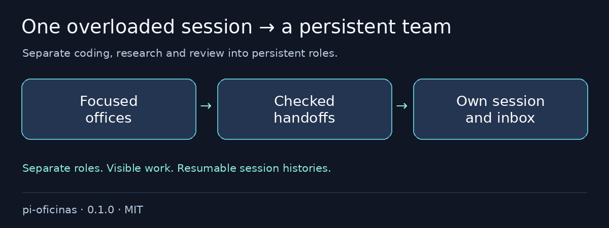

# @otixe/pi-oficinas

One Pi session is coding, reviewing and researching at once. Split it into a persistent team: each office keeps its own session history, identity, credentials and inbox, with checked handoffs before work begins.

[Español](README.es.md) · MIT

## Problems it removes

- One session juggling every role → persistent leader/office coordination.
- Accidental credential or session mix-ups → explicit roles, own-key resolution and nonce-bound opening gates.
- Invisible pending work → task bells, correspondence and local VM-turn coordination.



## Install in one command

From a reviewed local checkout:

```sh
pi install ./packages/pi-oficinas
```

### Requirements and configuration

Pi 1.4.0, Python 3.10+, Herdr and its official Pi integration (`herdr integration install pi`).

1. Adapt `examples/equipo.json` and `examples/distribucion.json` (schema 2 only). Use absolute paths under your own team base. Set a local `pi_bin` runtime pin or provision `<base>/runtime/node_modules/.bin/pi`; no global-runtime guess.
2. Set `PI_OFICINAS_EQUIPO` to an owned, nonsymlink configuration. Each body’s `.env` pointer must be unique and private (`0600`). Configure `AGENT_NAME`, `BODY_ROLE`, `AGENT_ENABLED`, own credential variable and `SOUL_PATH`; `examples/.env.example` has no credentials.
3. Provision/review body directories, matching leader/body agent profiles, `.pi/APPEND_SYSTEM.md` and `.pi/oficina-body`. The neutral example SOUL/profile are **inactive**, not production identities. Body creation is not automatic.
4. Supply a trusted backend integration with `cb_whoami` and `cb_vault_read`. Set `CEREBRO_BASE`, optional `CEREBRO_AUTH_HEADER` (default `X-API-Key`) and `PI_OFICINAS_HUMAN` (default `human`).
5. From the package directory, run `python3 bin/oficina --equipo /absolute/path/equipo.json abrir worker` inside the reviewed leader Herdr pane. The gate verifies fresh own-identity/SOUL tool results, model/thinking, tools, session and pane ownership. A marker alone grants nothing.

The secretary is inactive without a matching explicit body/team. Optional `pi_coding_agent_dir`, `pi_coding_session_dir`, `relanzar_modo` remain schema fields. A mini-helper may share only its own parent’s identity by body-local opt-in; `PI_OFICINAS_MINI_MODEL` can pin its canonical model. Never inherit another role’s key.

## Validation and rollback

To remove, `pi remove SOURCE`, then reload/restart your test session; preserve logs, snapshots and sessions.

Full monorepo configuration and reproducible validation: [README](https://github.com/otixe/pi-oficinas/blob/main/README.md), [VALIDATION](https://github.com/otixe/pi-oficinas/blob/main/VALIDATION.md).

## Security & limits

Review extension code before installation: it runs with process permissions, **not inside a sandbox**. Opening gates do not replace backend authorization or OS isolation. Body creation is not automatic; neutral profiles are inactive and a marker alone grants nothing. Never inherit another role's key. This package does **not** ship a Cerebro client, credentials or real souls.

Validated on Pi 1.4.0; the five host packages are peerDependencies `"*"`, never bundled copies. Wildcard peers are not a promise of compatibility with every host version. Tests use real Pi/Herdr with model/backend doubles and do **not** certify production authentication. Review source/trust before installation.

For local archives, extract the tarball and install its `package` directory: Pi 1.4.0 does not load `.tgz` extension sources even when `pi install` succeeds. The literal install exits 0; print/load exits 1. See the monorepo README for the supported extraction command.

Registry installation uses `pi install npm:@otixe/pi-oficinas@0.1.0` once the publisher releases that version. npm sources and repository/gallery URLs require separately authorized publication; a local checkout does not make them available.
