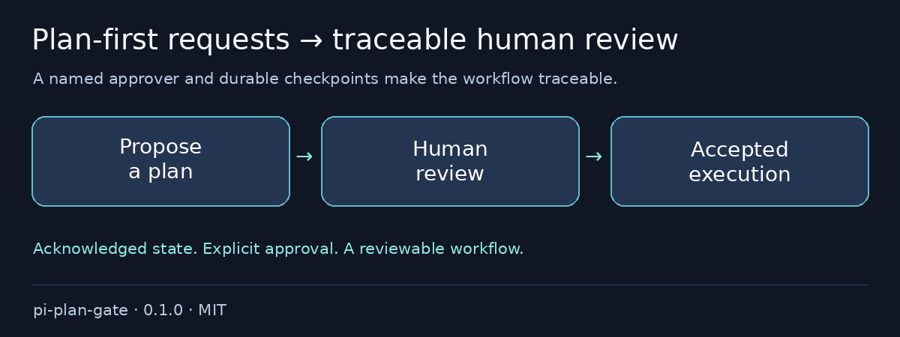

# @otixe/pi-plan-gate

“Please plan first” gets forgotten as soon as implementation starts. Give the plan a durable checkpoint and a named human approver: propose the work, wait for review, then execute the accepted plan.

[Español](README.es.md) · MIT

## Problems it removes

- Plans lost on reload → remotely acknowledged state restoration.
- Implementation beginning before review → planning/awaiting blocks for edit/write and delegation.
- Unclear approval provenance → matching owner ACK and configured human review activity.



## Install in one command

From a reviewed local checkout:

```sh
pi install ./packages/pi-plan-gate
```

### Configuration and backend

Set `PLAN_GATE_BASE_URL`, `PLAN_GATE_AGENT`, `PLAN_GATE_KEY_ENV` (default `PLAN_GATE_KEY`) and export that credential variable. Optional: `PLAN_GATE_AUTH_HEADER=X-API-Key`, `PLAN_GATE_APPROVER=human`, `PLAN_GATE_ROOT`, `PLAN_GATE_READONLY_AGENTS` (JSON array, default `[]`). Keys are environment-only; office/delegate principals fail closed.

The compatible backend must provide agent checkpoint save/latest plus `/task/create`, `/task/claim`, `/task/update`, `/task/submit`, `/task/get`, `/task/activity`, `/task/comment`, preserving owner attribution and review activity. State uses `session_ref=plan-gate`; only configured human `pass`/`needs_changes` reviews count. Failed ACK leaves the previous phase unchanged.

Tools: `plan_mode`, `plan_submit`, `plan_check`; command `/plan`. No URL means idle/inactive: you cannot enter planning without durable ACK. `/plan off` is a workflow override requiring remote confirmation, not a permission bypass.

Planning/awaiting block `edit`/`write` and unapproved subagents. Read the shell and restore-failure boundaries in **Security & limits** before relying on this workflow.

## Validation and rollback

To remove, `pi remove SOURCE`, then reload/restart your test session; preserve logs, snapshots and sessions.

Full monorepo configuration and reproducible validation: [README](https://github.com/otixe/pi-oficinas/blob/main/README.md), [VALIDATION](https://github.com/otixe/pi-oficinas/blob/main/VALIDATION.md).

## Security & limits

**`bash` and `bg_run` remain available and logged; other tools are not a complete write detector.** Shell can write files. This is a workflow gate, **not a security/read-only sandbox**. Logs may include command paths/secrets; inspect before sharing. Restore failure is visible but leaves idle: **it does not establish protection**.

Validated on Pi 1.4.0; the five host packages are peerDependencies `"*"`, never bundled copies. Wildcard peers do not promise every host version. Review source/trust before installation: extensions run with process permissions. Tests use model/backend doubles and do not certify production authentication.

For local archives, extract the tarball and install its `package` directory: Pi 1.4.0 does not load `.tgz` extension sources even when `pi install` succeeds. The literal install exits 0; print/load exits 1. The monorepo README shows the supported extraction command.

Registry installation uses `pi install npm:@otixe/pi-plan-gate@0.1.0` once the publisher releases that version. npm sources and repository/gallery URLs require separately authorized publication; a local checkout does not make them available.
