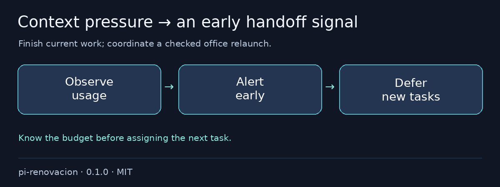

# @otixe/pi-renovacion

Un agente que trabaja largo no debería descubrir que agotó el contexto a mitad de su próxima tarea. Detectá presión a tiempo, terminá el trabajo actual y diferí nuevas tareas de oficina con alertas ligadas a sesión y coordinación verificada de relanzamiento.

[English](README.md) · MIT

## Dolores que resuelve

- Agotamiento inesperado de contexto → alertas configurables de uso/costo.
- Nuevas tareas para una oficina saturada → diferimiento ligado a sesión con uso alto o desconocido.
- Relanzamiento que compite con trabajo activo → coordinación guarded reutilizable y CLI explícita.



## Instalación en un comando

Desde un checkout local revisado:

```sh
pi install ./packages/pi-renovacion
```

### Configuración

`CONTEXT_ALERT=0` apaga alertas. Si no, el umbral default es `[80]`; configurable con `CONTEXT_ALERT_PCT=50,80`. `CONTEXT_WINDOW` prevalece sobre metadata del modelo; fallback de 1.000.000 tokens si falta. Configuralo para modelos desconocidos.

Las alertas notifican UI y anexan `state/context-budget-alert.jsonl`. Telegram es opcional mediante bridge ya instalado en el cuerpo y sólo en turnos originados allí.

`lib/context70.ts` difiere nuevas tareas al 70% o con uso desconocido, nunca cancela trabajo actual. Snapshots requieren archivos propios regulares y la misma sesión. Contexto alto obsoleto sigue alto hasta cambiar sesión. Las libs de relanzamiento requieren callbacks autenticados task/pane/gate y `officeCli`/`PI_OFICINAS_CLI` absoluto salvo inyección de `runRelaunch`. No se adivinan rutas a packages hermanos.

## Verificación y rollback

Para quitarlo, `pi remove SOURCE` y reiniciá/recargá tu sesión de prueba; preservá logs, snapshots y sesiones.

Configuración del monorepo y validación reproducible: [README](https://github.com/otixe/pi-oficinas/blob/main/README.es.md), [VALIDATION](https://github.com/otixe/pi-oficinas/blob/main/VALIDATION.md).

## Seguridad y límites

**No** es el controlador experimental automático del líder: no ejecuta su `/new`, cambia compaction/prompts ni afirma cosecha durable. El relanzamiento de oficina es una integración explícitamente validada. Costo ausente se muestra como cero, **no** como uso gratuito verificado. Los errores Telegram se capturan, no se afirma entrega; no se incluyen bridge ni credenciales.

Validado en Pi 1.4.0; los cinco paquetes host son peerDependencies `"*"`, nunca copias incluidas. Peers wildcard no prometen todas las versiones del host. Revisá fuente/trust antes de instalar: las extensiones corren con permisos del proceso, no en un sandbox. Las pruebas usan modelo/backend simulados y no certifican autenticación productiva.

Para archivos locales, extraé el tarball e instalá su directorio `package`: Pi 1.4.0 no carga sources de extensión `.tgz` aunque `pi install` tenga éxito. La instalación literal devuelve 0; la carga/print falla con exit 1. El README raíz muestra la extracción soportada.

La instalación desde registry usa `pi install npm:@otixe/pi-renovacion@0.1.0` una vez liberada esa versión por el publicador. Los sources npm y URLs de repositorio/galería requieren publicación autorizada por separado; un checkout local no los vuelve disponibles.
